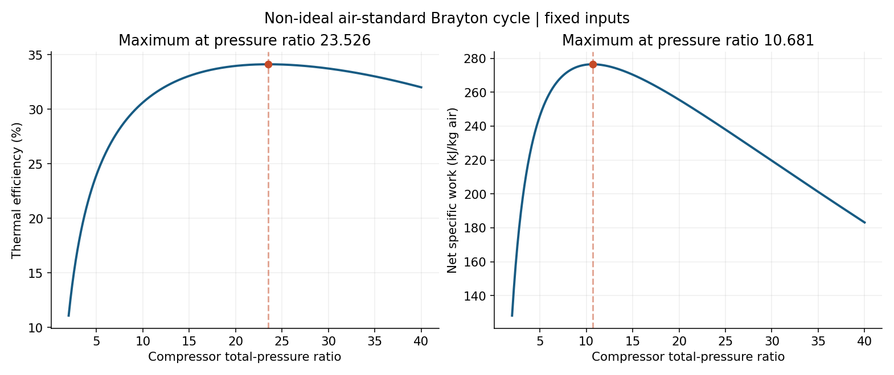
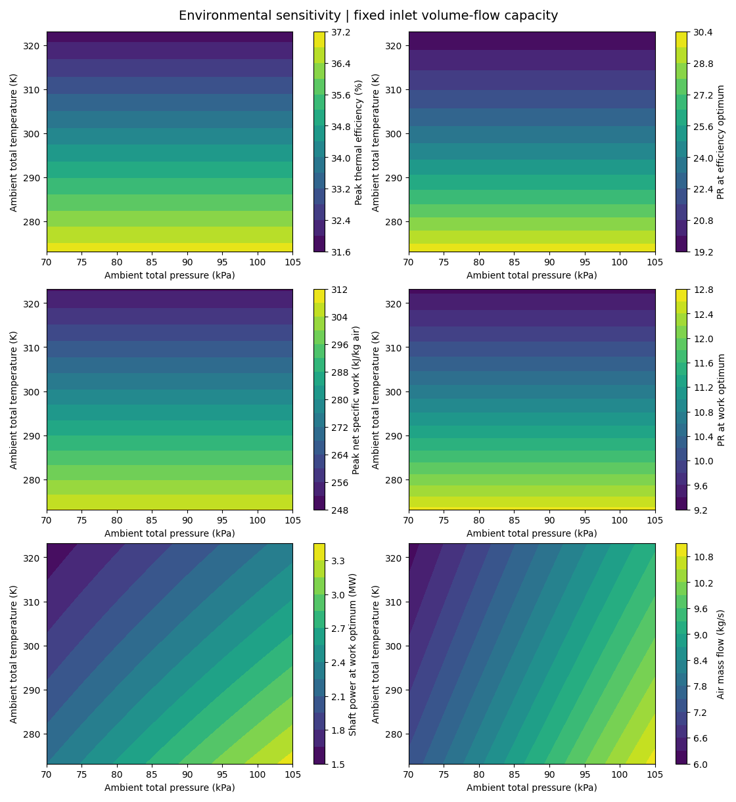

# Variable-Property Non-Ideal Brayton Cycle Model

An engineering study of how compressor pressure ratio and ambient conditions
shape gas-turbine cycle performance. Built in Python, the four-station
air-standard model uses temperature-dependent NASA7 air properties,
component efficiencies, pressure losses, and explicit energy accounting.

**Project status:** Complete for the intended thermodynamic modeling and
parameter-study scope. The model is analytically and numerically verified; it
is not calibrated against a particular engine or validated against test data.

**Development note:** AI tools assisted with code implementation and
refinement. The project objectives, selected assumptions, and engineering
interpretation are documented here; the model's limits are stated explicitly.

**License:** MIT for this project's code; see [`LICENSE`](LICENSE).
`THIRD_PARTY_NOTICES.md` identifies the separate Cantera-derived coefficient
attribution.

## Project highlights

- Sweeps compressor pressure ratio from 2 to 40 and finds separate optima for
  thermal efficiency and net specific work.
- Compares those objectives: the illustrative baseline peaks at **34.13%
  efficiency near PR 23.53**, while net specific work peaks at **276.50 kJ/kg
  near PR 10.68**.
- Extends the same cycle solver across ambient temperature and pressure while
  holding a notional inlet volume-flow capacity fixed. This separates specific
  cycle performance from the mass-flow effect on shaft power.
- Checks thermodynamic closure, property integrals, scalar root solutions,
  invalid cases, and optimization behavior with an automated test suite.

These results use stated educational assumptions, including fixed component
efficiencies and losses. They are model outputs, not measured engine
performance.

## Selected results

Baseline pressure-ratio sweep:

| Objective | Best PR | Thermal efficiency | Net specific work |
|---|---:|---:|---:|
| Maximum efficiency | 23.5264 | 34.131% | 243.318 kJ/kg |
| Maximum net specific work | 10.6807 | 31.109% | 276.498 kJ/kg |



Ambient-condition studies use 273.15–323.15 K and 70–105 kPa. At fixed
ambient temperature, pressure changes inlet density and modeled shaft power;
the ideal-gas specific cycle results stay invariant. See the [ambient study
results](results/environmental/RESULTS.md).



## Resume / portfolio summary

**Variable-Property Brayton Cycle Model** — Developed a Python model of a
non-ideal gas-turbine cycle using NASA7 temperature-dependent air properties,
component efficiencies, and pressure losses; optimized pressure ratio for
thermal efficiency and net specific work; and quantified ambient-condition
effects under a fixed inlet-volume-flow assumption. Verified numerical and
energy-balance behavior with analytical checks and automated tests.

For a shorter resume entry, retain only claims that fit the target role and
resume space. The [model assumptions and equation map](#equation-map),
[data sources](data_sources.md), and [computed results](results/RESULTS.md)
support technical discussion.

---

## Scope and use

The core design study sweeps compressor pressure ratio at fixed inputs and
fixed air mass flow. Its objectives are maximum thermal efficiency and maximum
net specific work, with an efficiency-versus-specific-work tradeoff plot. A
separate environmental-sensitivity module repeats that pressure-ratio study
over ambient temperature and pressure while holding a notional inlet volume-flow
capacity fixed.

## Running the project

Install Python 3.10 or newer, extract this folder, then open a terminal in it:

```bash
python -m pip install -r requirements.txt
python -m unittest -v
python study.py
python ambient_study.py
```

On Windows, `py` may replace `python`. The run writes plots, a sweep CSV, a full
precision summary JSON, and RESULTS.md into `results/`. `ambient_study.py`
writes its CSV files, plots, and summary into `results/environmental/`.
Rerunning replaces those generated outputs. No Cantera installation or network
connection is needed after installing dependencies. Verified with Python 3.12,
NumPy 2.3.5, SciPy 1.17.0, and Matplotlib 3.10.8.

## File guide and reverse learning order

1. Inspect `results/RESULTS.md`, then `results/environmental/RESULTS.md` and
   its three plots.
2. Read `baseline.json` for the fixed assumptions.
3. Trace `solve_cycle(12)` in `cycle.py` through your hand derivation.
4. Read `properties.py` for cp, enthalpy, entropy, and gamma.
5. Study `temperature_root` and `bisect_root` in `cycle.py`.
6. Read `study.py` for the sweep and optimization.
7. Read `test_model.py` to understand how the results are checked.

All station temperatures and pressures are TOTAL values. Internal velocities,
Mach numbers, geometry, compressor maps, and aircraft propulsion are outside scope.

## Illustrative baseline (not a calibrated Solar engine)

| Parameter | Value |
|---|---:|
| Inlet total temperature | 300 K |
| Ambient reservoir pressure | 101325 Pa |
| Turbine inlet total temperature | 1400 K |
| Compressor / turbine isentropic efficiency | 0.85 / 0.88 |
| Effective burner efficiency | 0.99 |
| Turbine mechanical efficiency | 0.99 |
| Inlet / combustor / exhaust pressure recovery | 0.99 / 0.96 / 0.99 |
| Equivalent fuel LHV | 50 MJ/kg |
| Constant air mass flow | 10 kg/s |
| Compressor pressure-ratio sweep | 2 to 40, 401 points |

These efficiency and loss values are explicit educational assumptions, not
values taken from engine measurements.

## Equation map

Units: K, Pa, J/kg, J/(kg K), kg/s, W. Results plots convert work to kJ/kg.

Pressure-ratio definitions and reservoir boundary conditions:

```text
P1 = pi_in * Pamb
P2 = PR * P1
P3 = pi_b * P2
P4 = Pamb / pi_ex
```

The exhaust condition assumes negligible kinetic energy at the downstream
reservoir. pi_ex models the total-pressure loss to that reservoir; this is not
a nozzle model or an assumption that turbine-exit static and total pressure
are always equal.

Compressor: Gibbs relation + ideal gas + isentropic-efficiency definition + First Law:

```text
s0(T2s) - s0(T1) - R*ln(P2/P1) = 0
wc = [h(T2s) - h(T1)] / eta_c
h(T2) - h(T1) = wc
```

Combustor: effective air-standard energy balance:

```text
q_added = h(T3) - h(T2)
q_fuel = q_added / eta_b
f = q_fuel / LHV
```

The air mass flow is unchanged through the combustor and turbine. f is an
equivalent fuel requirement, not added working-fluid mass. There is no (1+f)
multiplier in turbine work. Combustion products, dissociation, humidity, cooling
bleed and fuel sensible enthalpy are excluded.

Turbine: Gibbs relation + ideal gas + isentropic-efficiency definition + First Law:

```text
s0(T4s) - s0(T3) - R*ln(P4/P3) = 0
wt = eta_t * [h(T3) - h(T4s)]
h(T4) = h(T3) - wt
```

Cycle work accounting and thermal-efficiency definition:

```text
wnet = eta_m * wt - wc
shaft_power = mass_flow * wnet
efficiency = wnet / q_fuel
```

eta_m is a turbine fluid-to-shaft factor applied BEFORE subtracting compressor
work. It is not a mechanical factor on net work. There is no additional compressor
mechanical efficiency or generator efficiency. Power density means specific work
(kJ/kg air), not power per engine volume or engine mass. At fixed air mass flow,
maximizing specific work also maximizes shaft power.

## Property method and numerical solution

Air is modeled as 79% N2 and 21% O2 by mole, with temperature-dependent NASA7
cp polynomials. h and s0 are analytical integrals of cp and cp/T respectively,
referenced to 200 K and integrated piecewise at 1000 K. They remain continuous
at the coefficient boundary. Valid mixture range: 200-3500 K.

SciPy's bracketed Brent solver finds four scalar temperature roots sequentially.
The independent bisection implementation checks these roots. Exactly ideal
component efficiencies use T2=T2s and T4=T4s directly. The formulation needs no
simultaneous matrix or Gauss-Seidel iteration.

The study samples the domain, refines sampled local maxima with bounded scalar
minimization of each negative objective, and compares against feasible endpoints.
Invalid cycle points remain in the CSV with reasons. Endpoint optima are flagged;
results apply only to the configured design domain. With fixed efficiencies and
losses, the sweep is a design-cycle study, not off-design operation of one engine.

## Verification

Ten tests cover ideal analytical states/work/efficiency; the analytical ideal
maximum-work pressure ratio and efficiency endpoint; a lossy constant-property
analytical case; property integrals versus independent numerical quadrature;
Brent versus bisection; energy closure, entropy generation and state ordering;
mass-flow scaling and the fuel-mass correction; invalid/infeasible inputs; and
optima versus an independent 2001-point grid.

This is numerical and thermodynamic verification. No measured-engine validation
or independent textbook air-table comparison is claimed. Source assumptions and
coefficient provenance appear in `data_sources.md`.

## Environmental-sensitivity extension

`ambient_study.py` preserves the validated cycle solver and reruns its same
pressure-ratio sweep (PR = 2--40) for:

- ambient total temperature from 273.15 to 323.15 K;
- ambient total pressure from 70 to 105 kPa; and
- their 21 × 15 combined grid.

The module defines a reference inlet volume flow from 10 kg/s at 288.15 K and
101.325 kPa, then uses the ideal-gas relation

```text
rho = Pamb / (R_air * Tamb)
mdot = rho * Vdot_reference
shaft power = mdot * wnet
```

This deliberately separates specific cycle performance from installed shaft
power. With fixed component efficiencies, pressure ratios, and TIT, ambient
pressure cancels out of the ideal-gas specific-work and efficiency relations;
it changes power here through inlet density and mass flow. Ambient temperature
changes both the thermodynamic cycle and the inlet density.

Accordingly, the ambient-pressure figure intentionally plots only density, air
mass flow, shaft power, and percentage power change. It reports the optimized
specific-cycle results as invariant values in a callout rather than magnifying
floating-point-level optimizer differences as apparent physical trends.

This is **not** a compressor-map-based off-design model: corrected speed, map
flow capacity, surge margin, turbine flow matching, controls, and geometry are
held outside scope. The fixed-volume-flow assumption is a transparent proxy for
comparing available inlet-air capacity, not a claim that a real compressor holds
the same volume flow at all ambient conditions.
